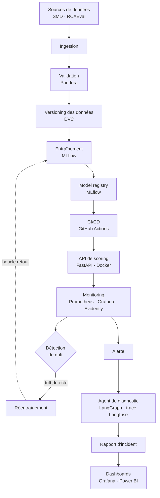

<div align="center">

# OpsSentinel — AIOps & MLOps

**Détecter les incidents de microservices avant qu'un seuil ne sonne, puis en trouver la cause racine.**


</div>

---

## Sommaire

1. [Le problème et la solution](#1-le-problème-et-la-solution)
2. [Architecture](#2-architecture)
3. [Données](#3-données)
4. [Stack technique](#4-stack-technique)
5. [Structure du repository](#5-structure-du-repository)
6. [Démarrage rapide](#6-démarrage-rapide)
7. [Workflow Git](#7-workflow-git)
8. [Feuille de route](#8-feuille-de-route)
9. [Équipe](#9-équipe)
10. [Références](#10-références)

> **État du projet** : le projet est en phase d'initialisation. Les fonctionnalités
> décrites ci-dessous sont **prévues** ; aucune n'est encore livrée et aucun résultat
> n'est encore disponible.

---

## 1. Le problème et la solution

### Le problème

Les alertes à seuil fixe (« CPU > 80 % ») ratent les dégradations lentes et
génèrent de fausses alertes.

Exemple observé dans nos données (RCAEval) : lors d'une panne CPU, le CPU du service
plafonne à 30 %, mais sa latence est multipliée par 10 et se propage aux services
appelants. Un seuil fixe sur le CPU ne l'aurait jamais détectée.

### La solution

OpsSentinel combine un cycle MLOps complet et un agent LLM :

1. un **détecteur d'anomalies** apprend le comportement normal de chaque service ;
2. il **détecte les incidents** lorsque ce comportement s'écarte de la normale ;
3. il **se réentraîne automatiquement** quand le comportement normal change (*drift*) ;
4. un **agent LLM enquête** et identifie la cause racine **en citant ses preuves**.

### Trois volets

| Volet | Périmètre |
|---|---|
| **MLOps** | Cycle de vie du modèle : données versionnées, entraînement tracé, registry, CI/CD, déploiement, monitoring, réentraînement |
| **AIOps** | Surveillance de systèmes informatiques : détection d'anomalies et diagnostic d'incidents sur des microservices |
| **LLMOps** | Agent tracé, évalué, avec mesure des hallucinations |

---

## 2. Architecture

Architecture cible (prévue) :



---

## 3. Données

Les données ne sont **pas stockées dans Git** : elles sont téléchargées par script.

| Dataset | Rôle | Contenu | Licence | Lien |
|---|---|---|---|---|
| **SMD** (Server Machine Dataset) | Détecteur d'anomalies et boucle MLOps | 28 serveurs de production réels, répartis en 3 groupes selon le service hébergé ; 38 métriques par serveur ; une mesure par minute ; environ 5 semaines ; 708 405 lignes d'entraînement et 708 420 de test ; 4,16 % d'anomalies étiquetées | MIT | [OmniAnomaly](https://github.com/NetManAIOps/OmniAnomaly) |
| **RCAEval — Online Boutique (RE2-OB)** | Évaluation de l'agent de diagnostic | 90 cas = 5 services en panne (checkout, currency, email, productcatalog, recommendation) × 6 types de panne (cpu, mem, disk, delay, loss, socket) × 3 répétitions ; environ 24 minutes par cas, une mesure par seconde (12 min normales puis la panne) ; 69 à 75 métriques nommées `<service>_<mesure>`, plus logs et traces ; service fautif, type de panne et heure d'injection connus pour chaque cas | MIT | [GitHub](https://github.com/phamquiluan/RCAEval) · [Hugging Face](https://huggingface.co/datasets/phamquiluan/RCAEval) |

---

## 4. Stack technique

| Outil | Rôle | Pourquoi ce choix |
|---|---|---|
| **Pandera** | Validation des données | Schémas déclaratifs, intégrés à pandas |
| **DVC** | Versioning des données | Garde les gros fichiers hors de Git tout en les rendant reproductibles |
| **MLflow** | Suivi des expériences et model registry | Standard ouvert, un seul outil pour tracer et versionner les modèles |
| **GitHub Actions** | CI/CD | Natif au repository, gratuit à cette échelle |
| **FastAPI** | API de scoring | Léger, typé, documentation OpenAPI automatique |
| **Docker** | Conteneurisation | Environnement identique en développement et en déploiement |
| **Prometheus** | Collecte des métriques | Référence pour les métriques de services |
| **Grafana** | Dashboards techniques | S'appuie directement sur Prometheus |
| **Evidently** | Détection de drift | Rapports de dérive de données prêts à l'emploi |
| **LangGraph** | Orchestration de l'agent | Flux d'enquête explicite sous forme de graphe |
| **Langfuse** | Traçage et évaluation de l'agent | Traces et métriques LLMOps open source |
| **Power BI** | Dashboards de synthèse | Restitution orientée métier des incidents |

> **Choix d'exclusion** : Kubernetes et Kafka sont volontairement écartés. Ils ne sont pas
> justifiés à l'échelle de ce projet ; Docker et un traitement par lots suffisent.

---

## 5. Structure du repository

```text
Opssentinel-MLops/
├── .github/workflows/   # Pipelines CI/CD (GitHub Actions)
├── configs/             # Fichiers de configuration
├── data/
│   ├── raw/             # Données brutes téléchargées (hors Git)
│   └── processed/       # Données transformées (hors Git)
├── docker/              # Dockerfiles et configuration de conteneurs
├── docs/                # Documentation du projet
├── notebooks/           # Exploration et analyses
├── scripts/             # Scripts utilitaires (téléchargement, exploration)
├── src/
│   ├── ingestion/       # Chargement des données
│   ├── validation/      # Contrôles de qualité (Pandera)
│   ├── features/        # Construction des variables
│   ├── training/        # Entraînement et suivi (MLflow)
│   ├── serving/         # API de scoring (FastAPI)
│   ├── monitoring/      # Métriques et détection de drift
│   └── agent/           # Agent de diagnostic (LangGraph)
└── tests/               # Tests automatisés
```

| Dossier | Rôle |
|---|---|
| `.github/workflows/` | Pipelines d'intégration et de déploiement continus |
| `configs/` | Paramètres du projet, séparés du code |
| `data/` | Données locales, ignorées par Git (`raw/` et `processed/`) |
| `docker/` | Images et configuration de déploiement |
| `docs/` | Documentation technique et de projet |
| `notebooks/` | Notebooks d'exploration |
| `scripts/` | Scripts hors application ; contient pour l'instant `explore_rcaeval_index.py`, qui explore l'index des cas RCAEval |
| `src/ingestion/` | Lecture et chargement des sources de données |
| `src/validation/` | Schémas et contrôles de qualité des données |
| `src/features/` | Préparation des variables pour le modèle |
| `src/training/` | Entraînement du détecteur et suivi des expériences |
| `src/serving/` | API de scoring |
| `src/monitoring/` | Monitoring et détection de drift |
| `src/agent/` | Agent LLM de diagnostic |
| `tests/` | Tests unitaires et d'intégration |

> La plupart des dossiers sont pour l'instant des squelettes vides, prêts à accueillir le code.

---

## 6. Démarrage rapide

**Prérequis** : Python 3.12 et Git.

```bash
# 1. Cloner le repository
git clone <url-du-repository>
cd Opssentinel-MLops

# 2. Créer l'environnement virtuel
python -m venv .venv

# 3. Activer l'environnement
#    Windows (PowerShell)
.venv\Scripts\Activate.ps1
#    Linux / macOS
source .venv/bin/activate

# 4. Installer les dépendances                          (à venir : requirements.txt)
pip install -r requirements.txt

# 5. Télécharger les données                            (à venir : script de téléchargement)
python scripts/download_data.py
```

| Étape | Statut |
|---|---|
| Cloner le repository, créer le `.venv` | Disponible |
| Installer les dépendances | À venir |
| Télécharger les données (SMD, RCAEval) | À venir |
| Lancer l'API, l'entraînement, l'agent | À venir |

---

## 7. Workflow Git

- La branche **`main` est protégée** : aucun commit direct.
- **Une branche par ticket Jira**, nommée `feature/OPS-<numéro>-<description>`.
- Les **commits sont préfixés par la clé du ticket**.
- Chaque changement passe par une **Pull Request relue par un autre membre** de l'équipe.

```bash
git checkout -b feature/OPS-2-ingestion-smd
git commit -m "OPS-2: ajoute le chargement des fichiers SMD"
git push -u origin feature/OPS-2-ingestion-smd
# puis ouvrir une Pull Request vers main
```

---

## 8. Feuille de route

Plan sur 8 semaines.

- [x] Initialisation du repository
- [ ] **S1-2 — Données et baseline** : ingestion, validation, premier détecteur de référence
- [ ] **S3-4 — API déployée, monitoring, boucle complète** : API de scoring, monitoring, cycle de bout en bout
- [ ] **S5-6 — Drift, réentraînement automatique, agent** : détection de drift, réentraînement automatique, agent de diagnostic
- [ ] **S7 — LLMOps complet et Power BI** : traçage et évaluation de l'agent, dashboards Power BI
- [ ] **S8 — Documentation et démo** : documentation finale et démonstration

---

## 9. Équipe

| Rôle | Membre |
|---|---|
| Données et modèle | [Prénom Nom] |
| Plateforme et monitoring | [Prénom Nom] |
| Agent et LLMOps | [Prénom Nom] |

Projet de groupe réalisé dans le cadre du cours de MLOps.

---

## 10. Références

- **SMD** — Su, Y., Zhao, Y., Niu, C., Liu, R., Sun, W., Pei, D. *Robust Anomaly Detection for Multivariate Time Series through Stochastic Recurrent Neural Network* (OmniAnomaly). KDD 2019. [Dépôt](https://github.com/NetManAIOps/OmniAnomaly)
- **RCAEval** — Pham, L. et al. *RCAEval: A Benchmark for Root Cause Analysis of Microservice Systems with Telemetry Data*. WWW 2025. [Dépôt](https://github.com/phamquiluan/RCAEval) · [Hugging Face](https://huggingface.co/datasets/phamquiluan/RCAEval)
